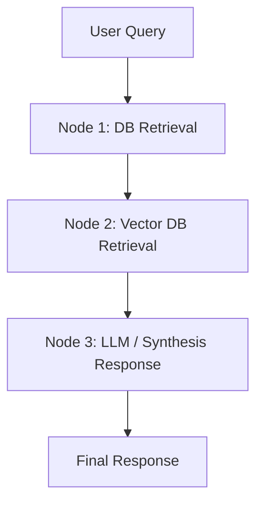

# 🎓 Student Database Backend & AI Chatbot

A high-performance **FastAPI** backend integrated with **SQLAlchemy** for relational student database operations, **ChromaDB** for vector store embeddings, and **LangGraph** for multi-step AI chatbot retrieval workflows.

---

## 📁 Project Structure

```text
student-database-backend/
│
├── app/
│   ├── __init__.py
│   ├── main.py          # FastAPI app entry point & route definitions
│   ├── database.py      # SQLAlchemy engine & session setup
│   ├── models.py        # SQLAlchemy ORM models (Database tables)
│   ├── schemas.py       # Pydantic schemas (Data validation & serialization)
│   ├── crud.py          # Database operations (CRUD logic)
│   └── chatbot/
│       ├── __init__.py
│       ├── graph.py     # LangGraph state graph workflow definition
│       └── vector_db.py # Vector database (ChromaDB) integration
│
├── .env                 # Environment variables (API keys, DB settings)
├── .gitignore           # Git ignore file
├── requirements.txt     # Python dependencies
└── README.md            # Project documentation
```

---

## 🛠️ Technology Stack

- **Framework:** [FastAPI](https://fastapi.tiangolo.com/) (Python 3.10+)
- **Server:** [Uvicorn](https://www.uvicorn.org/)
- **Database:** [SQLAlchemy 2.0](https://www.sqlalchemy.org/) (SQLite / PostgreSQL ready)
- **Data Validation:** [Pydantic V2](https://docs.pydantic.dev/)
- **AI Agent Workflow:** [LangGraph](https://python.langchain.com/docs/langgraph) & [LangChain](https://python.langchain.com/)
- **Vector Database:** [ChromaDB](https://www.trychroma.com/)

---

## 🚀 Getting Started

### 1. Clone & Set Up Virtual Environment

```bash
# Navigate to project root
cd student-database-backend

# Create virtual environment
python -m venv venv

# Activate virtual environment
# Windows (PowerShell):
.\venv\Scripts\Activate.ps1
# Linux/macOS:
source venv/bin/activate
```

### 2. Install Dependencies

```bash
pip install -r requirements.txt
```

### 3. Configure Environment Variables

Create or edit the `.env` file in the root directory:

```env
APP_NAME="Student Database API & AI Assistant"
DEBUG=True
DATABASE_URL="sqlite:///./students.db"

# Configure your Gemini API key and model for AI responses
GEMINI_API_KEY="your_gemini_api_key_here"
GEMINI_MODEL="gemini-3.8-flash"
CHROMA_PERSIST_DIR="./chroma_db"
```

### 4. Run the Server

```bash
uvicorn app.main:app --reload --port 8000
```

The API will be live at: `http://localhost:8000`

---

## 📖 API Documentation & Interactive Docs

Once the server is running, explore and test the interactive APIs:
- **Swagger UI:** [http://localhost:8000/docs](http://localhost:8000/docs)
- **ReDoc UI:** [http://localhost:8000/redoc](http://localhost:8000/redoc)

---

## 🤖 AI Chatbot & LangGraph Workflow

The chatbot utilizes a **LangGraph StateGraph** to process user queries through a 3-step pipeline:



1. **`retrieve_db` Node:** Searches relational tables (Students, Courses) for keywords (e.g. GPA, major, course code).
2. **`retrieve_vector` Node:** Performs similarity search against ChromaDB vector embeddings.
3. **`generate_answer` Node:** Combines context and generates a synthesized answer via Google Gemini API (or structured fallback).

---

## 🔌 API Endpoints Summary

| Category | Method | Endpoint | Description |
| :--- | :--- | :--- | :--- |
| **Health** | `GET` | `/` | Root API status & info |
| **Health** | `GET` | `/health` | System health check |
| **Students** | `POST` | `/api/students` | Create new student record |
| **Students** | `GET` | `/api/students` | List students (filters: `major`, `min_gpa`, `search`) |
| **Students** | `GET` | `/api/students/{id}` | Get student by ID |
| **Students** | `PUT` | `/api/students/{id}` | Update student details |
| **Students** | `DELETE` | `/api/students/{id}` | Delete student record |
| **Courses** | `POST` | `/api/courses` | Create new course |
| **Courses** | `GET` | `/api/courses` | List courses (filter: `department`) |
| **Enrollments**| `POST` | `/api/enrollments` | Enroll student in a course |
| **AI Assistant**| `POST` | `/api/chat` | Query LangGraph AI assistant |
| **Vector DB** | `POST` | `/api/vector-db/index` | Index text document into ChromaDB |
| **Vector DB** | `GET` | `/api/vector-db/search`| Direct vector similarity search |
| **Utility** | `POST` | `/api/seed` | Seed database & vector store with sample data |

---

## 🧪 Testing the API

### Seed Sample Data

Run a POST request to seed sample students, courses, and vector docs:

```bash
curl -X POST "http://localhost:8000/api/seed"
```

### Query the AI Chatbot

```bash
curl -X POST "http://localhost:8000/api/chat" \
     -H "Content-Type: application/json" \
     -d '{"message": "Which Computer Science students have a GPA above 3.5?"}'
```

---

## 📄 License

MIT License. Built for modularity and scalability.
